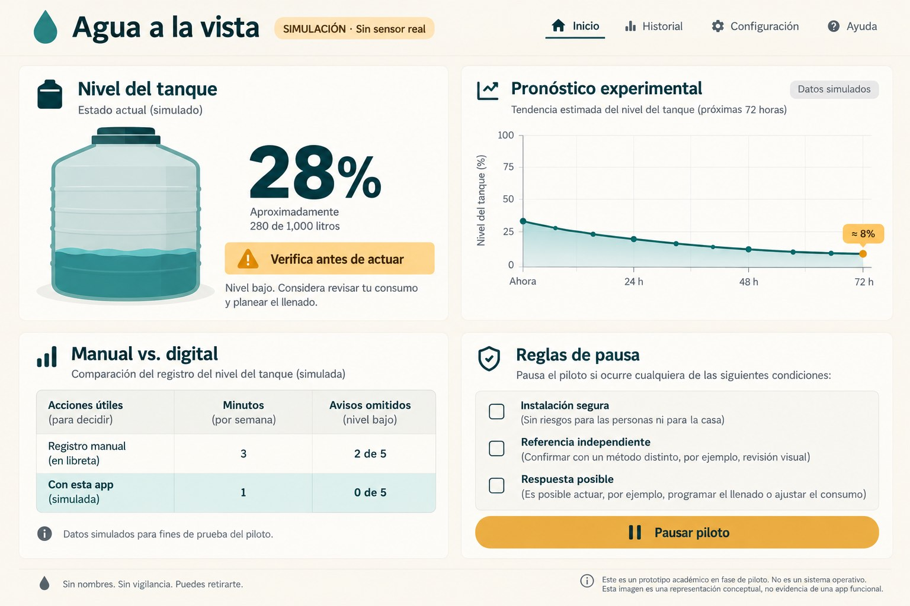
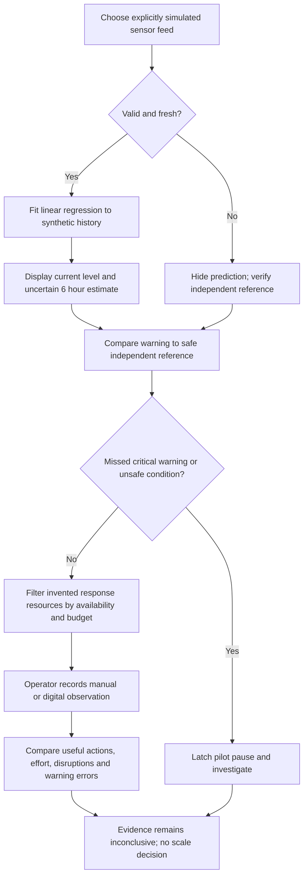
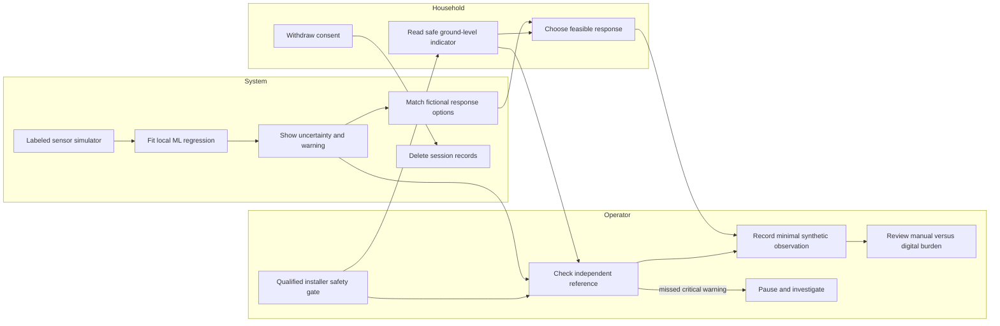

# PACKET — Agua a la vista
Prepared before application code, 25 October 2026 (America/Mexico_City).
Author: Emiliano Carballido. Role: **ADVERSARY**, implementing the **ADVERSARY / OPERATOR declaration**.
Source: uploaded *BLUEPRINT_team WEEK 11 final.pdf*, page 1. It is explicitly a proposed synthesis; team confirmation is not established.

## Problem in my words
A water reading is useful only when a household can act safely. Digital warnings can add false confidence, unpaid work and surveillance without creating water. This slice makes the manual alternative visible and makes stopping a pilot possible.

## Exact user
An adult managing stored household water under intermittent supply in Mexico City, together with a pilot operator responsible for safe installation, independent verification and minimal records. The synthetic test persona is Doña Mari, 54, a food seller comfortable with WhatsApp but distrustful of apps. This persona is an invented test fixture, not an interviewed person. The Blueprint reports a published household story, no completed household pilot.

## Success before the module closes
A public URL lets a visitor choose a labeled simulated sensor scenario, see an experimental fitted ML trend, compare a warning against a safe independent simulated reference, match a feasible response from an invented local resource list, record a manual or digital observation, compare useful actions and effort, and trigger a persistent-in-session stop. No real data, hardware or proven reliability is claimed.

## Generated-image mockup

Created with the built-in image generation tool before application coding. This is a concept, not a screenshot or trial result. The illustration's table values, 72-hour projection and text are illustrative: the build will use a bounded six-hour prediction and explicit safe, ground-level reference checks. The image must not be read as instructions to climb or as measured comparison evidence.

Prompt: “Use case: ui-mockup. Create one high-fidelity desktop web app mockup for a student prototype 'Agua a la vista'. Spanish interface, warm ivory background, dark teal typography and teal water tank graphic, amber warning. This is household tank monitoring and ADVERSARY / OPERATOR pilot safety, not marketing. Header text 'Agua a la vista', small badge 'SIMULACIÓN · Sin sensor real'. Main card shows tank '28%' and 'Verifica antes de actuar'. Secondary card 'Pronóstico experimental' with simple falling line chart and 'Datos simulados'. Lower cards: 'Manual vs. digital' with compact comparison table 'Acciones útiles', 'Minutos', 'Avisos omitidos'; 'Reglas de pausa' with checkboxes 'Instalación segura', 'Referencia independiente', 'Respuesta posible'. Button 'Pausar piloto'. Footer 'Sin nombres. Sin vigilancia. Puedes retirarte.' Clear readable UI, no photos, polished restrained academic prototype. This image is a conceptual mockup, not evidence of a working app.”

## Blueprint conditions and role
| Condition | Concrete implementation / limit |
| --- | --- |
| 2: qualified installation; no roof climbing; pause missed critical warnings | Default safety checklist; explicit ground-level independent reference; missed-warning detection latches pause; operator investigation required. No installation instructions. |
| 4: shadow clause | No accounts, database, names, addresses, phone numbers, geolocation, analytics, landlord views, data sale, payment enforcement, remote valves or individual blame. In-memory synthetic records only; withdrawal deletes them immediately; reload also clears records. Explicit deletion policy. |
| 5: uncertainty and independent warning verification | Fitted linear regression on labeled synthetic points; sample count and fit error; missing/stale data suppress prediction; safe reference comparison; low-event count and “inconclusive” conclusion. Six fictional households do not establish demand or reliability. |
| 1, 3, 6: supporting boundaries | Response must be feasible; no claim to create water or establish potability. Printable manual log without subscription; digital must earn benefit. No scaling or funded-pilot claim. Full cost worksheet is USER/MONEY's declaration, outside this role's required slice. |

## Flow

## Swimlane

## Benchmark
The best existing solution on Earth **selected as our benchmark for household water monitoring** is Phyn Protect, which combines pressure analysis, leak alerts and automatic shutoff; this is a scoped benchmark choice, not a verified universal ranking.
Mine differs/localizes by testing a manual-first, Spanish-language tank-level workflow in Mexico City, with independent warning checks and explicit bans on remote shutoff and household surveillance.
Sources checked 25 October 2026: https://phyn.com/products/phyn-protect and https://helpcenter.phyn.com/help/understanding-leak-alerts .
Local operational reference: Isla Urbana offers specialist advice and maintenance support (https://islaurbana.mx/servicios/); this does not establish a partnership, local availability, prices or validation of this prototype.

## Long view — three sentences
In three years this could become a locally operated household water-control service whose manual indicator remains usable without an account. Digital warnings would be added only when independent trials show useful actions or reduced effort at a fully funded support cost. Residents would retain withdrawal and deletion rights, with no landlord surveillance, remote enforcement or individual blame for shared tanks.

## Scope cut
No real sensor, plumbing work, water-quality judgment, actual supplier booking, payment, authentication, backend, database, notifications, household recruitment, demand validation or cost claims. No awareness campaign or recycling-tips app. No real household pilot tonight.

## Architecture and Dragon Stack
| Layer | Choice | Evidence / constraint |
| --- | --- | --- |
| IoT / sensing | Deterministic timestamped simulated tank feeds | On-screen SIMULACIÓN labels; low, stable, refill, stale, missed-warning scenarios |
| ML | Ordinary least-squares regression fitted in browser | Actual fitted slope/intercept and residual error on synthetic observations; no LLM/API calls; no validated forecast claim |
| Third technology | Marketplace-style resource matching | Filter fictional response offers by availability and budget; return feasible option or no match; no booking, sales or real prices |
| Interface | Buildless HTML, CSS, JavaScript modules | Spanish, responsive, keyboard labels, no external runtime dependencies |
| Records | In-memory only, fixed anonymous fictional household codes | Withdraw/reload clears; zero remote storage; print as manual worksheet |
| Hosting/source | Free static hosting / supplied GitHub repository | Prefer public production Vercel; do not purchase or upgrade anything |
| Testing | Node built-in test runner plus browser walk-through | Preserve actual failures and fixes; synthetic persona in fresh agent context |

## Pilot log and stop checklist design
Protocol from Blueprint: six households; two-week baseline, then two weeks per condition in randomized order (three in each sequence). The app is an observation-log demonstration, not execution of this protocol; actual randomization, recruitment and consent remain future work.
Log: fictional household code H01–H06, condition (manual/digital), useful action, checking minutes, support minutes, disruption, supply change, safe reference level and whether warning occurred. Aggregate by condition; never infer benefit from unequal exposure.
Pause on unsafe installation, missing safe reference, no feasible response, withdrawal or any missed critical warning. Independent reference at or below a prototype 20% threshold counts as a low event; threshold is a test assumption requiring field calibration. Check false positives and false negatives. “Too few events” and all synthetic results stay inconclusive; no six-household market claim.
Deletion date: end of current browser session (or immediate withdrawal). No localStorage/cookies, no export of personal information.

## Security floor
1. No secrets or paid APIs.
2. No personal data is accepted or stored; all entries are numeric/enum synthetic fixtures. Consequently personal-data auth is not applicable to this demo.
3. No Supabase/database, so RLS is not applicable.
4. Validate numeric bounds, required values, finite values and enum membership; render user values as text.
5. Only invented seeds and persona, labeled in UI and documents.
Host over HTTPS with restrictive content security policy, no third-party scripts, no cross-origin requests and no framing.

## Test plan and acceptance
- Regression fits known declining/flat data; cannot predict from insufficient, invalid or stale observations; refills invalidate the simple trend.
- Warnings: independent low reference + absent warning pauses; false positive recorded without implying reliability; stop remains after scenario change.
- Form: reject blanks, negative/out-of-range/non-finite values; accept boundary zero and 100.
- Log: manual/digital totals and warning-error counts match entered observations; supply changes retained; synthetic evidence always inconclusive.
- Privacy: no storage/network writes; withdrawal deletes and stops; print exposes no identity.
- Response matcher: no unavailable/over-budget fictional offer; no-match message invites pause.
- Browser: desktop/mobile readable; labels, keyboard, action flow, reset/withdraw/print work.
- Fresh synthetic persona sees sequential screenshots, narrates hesitations; fix worst observed confusion and retest.
- Mechanical pass records a real discovered bug, regression test, fix and second deployment. Do not manufacture a bug or invent a test result.

## Five-commit / two-deployment plan
1. Packet before code (this document).
2. Minimal sensor/ML/response prototype plus generated mockup asset.
3. Pilot log, safety tests and deployable first version; **deployment 1**.
4. Observed mechanical and persona fixes with regression evidence; **deployment 2**.
5. Session Close: DECISIONS, test/deployment evidence, packet/persona/buildchat PDFs and demo guidance.
Avoid auto-deploying the documentation-only close commit if hosting allows. Exactly five meaningful commits is the user's constraint; assignment minimum is five.
Record actual commit SHAs and actual deployment results, never planned actions as completed.

## Implementation prompt
Implement this packet in small testable pieces using buildless JavaScript. Start with pure functions for sensor fixtures, regression, warning classification, resource matching and aggregation; use them from the Spanish UI. Gate the simulated pilot on safety/reference/response checks, latch missed-warning pauses, validate every form and keep all records ephemeral. Implement manual-versus-digital log and uncertainty before polish. Run the stated tests, preserve observed failures, deploy v1, perform a fresh synthetic persona review using screenshots, fix the most consequential confusion and real mechanical bug, then deploy v2. Close with evidence, three PDFs and a 3 minute + 30 second demo script; report any unmet requirement honestly.

